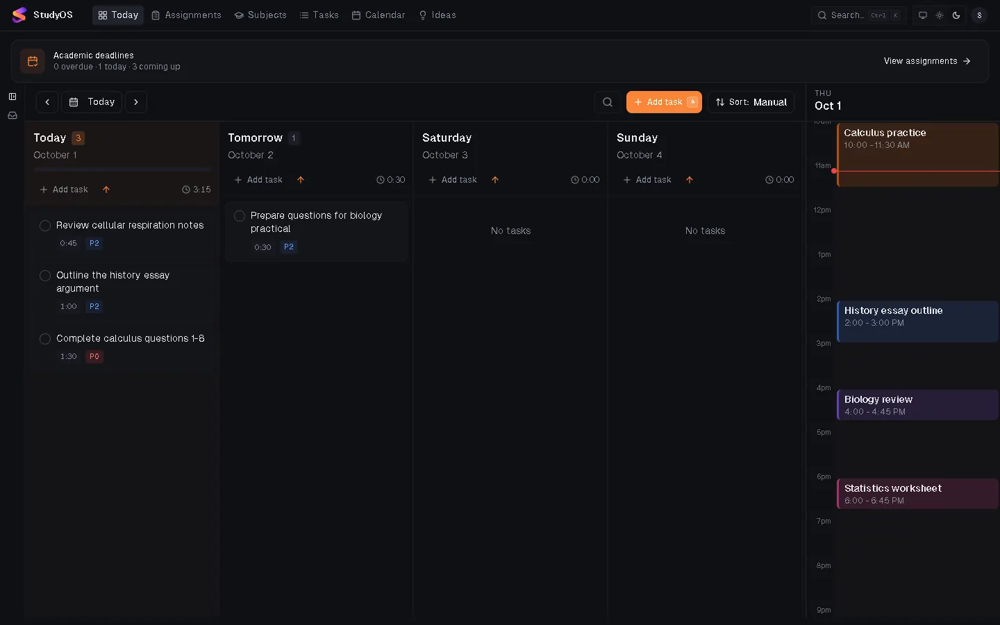
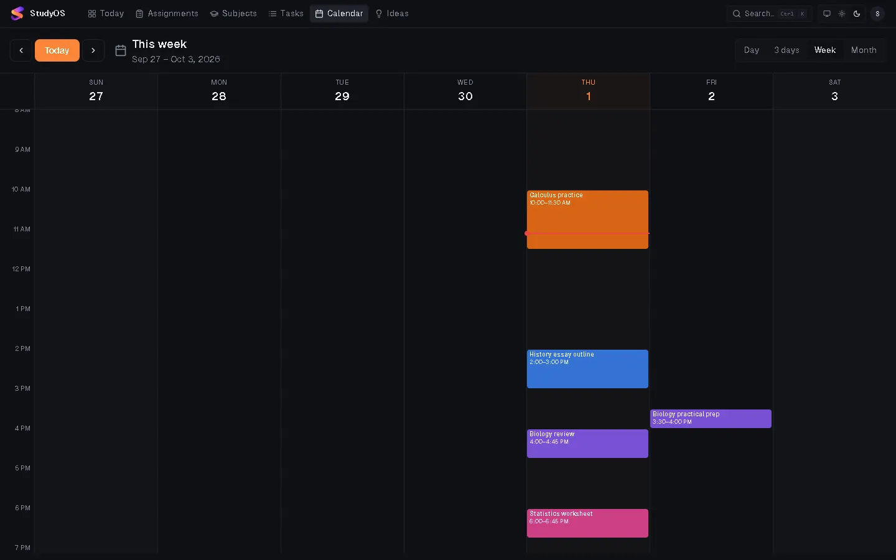
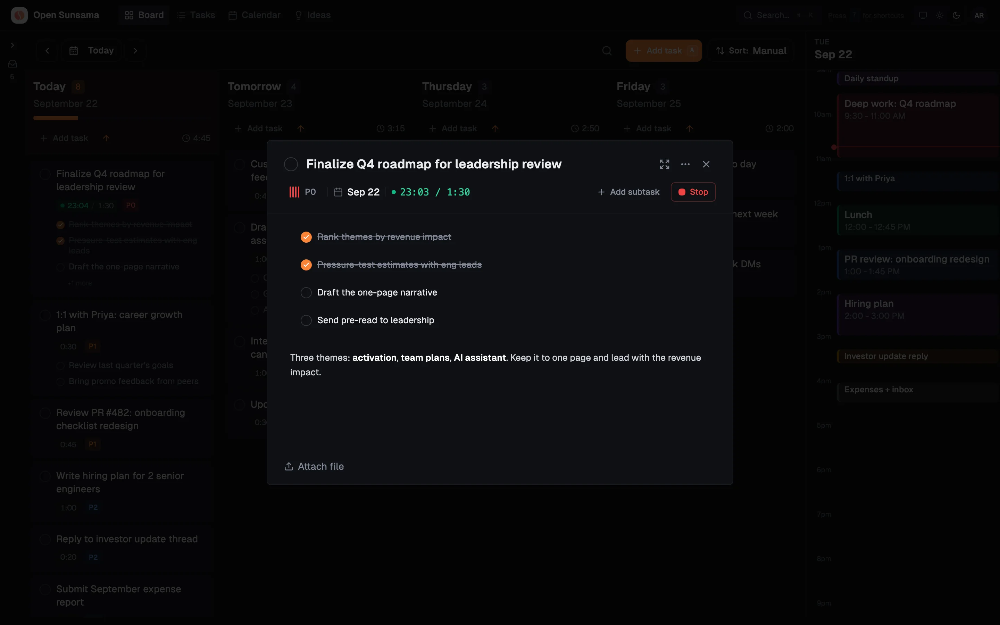
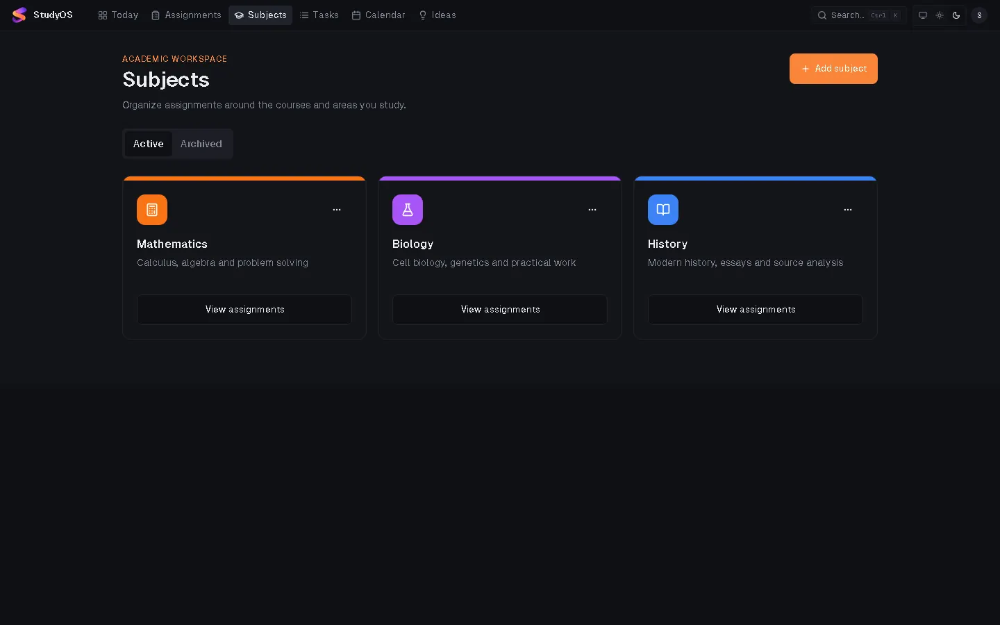
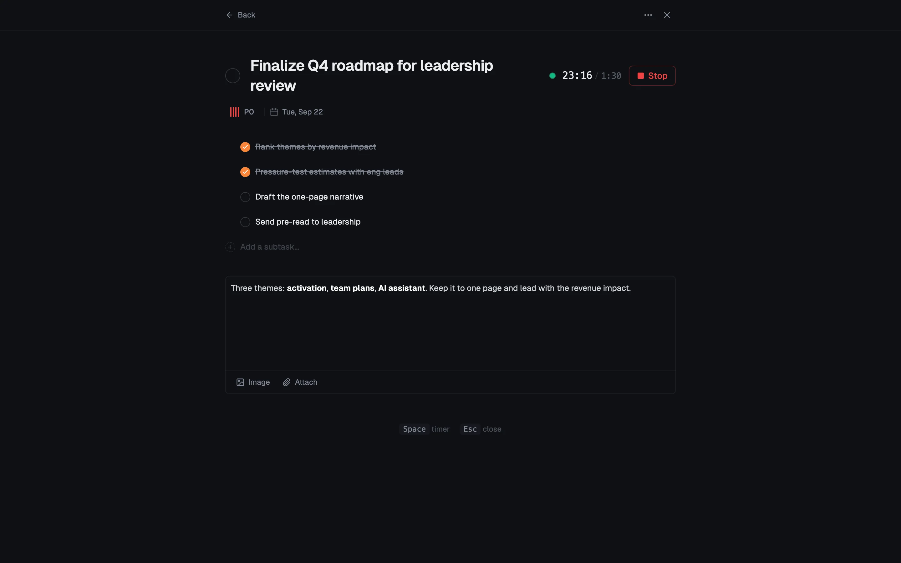
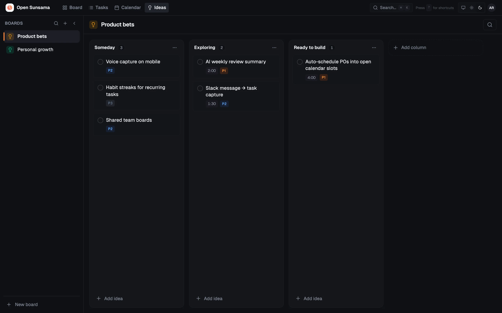
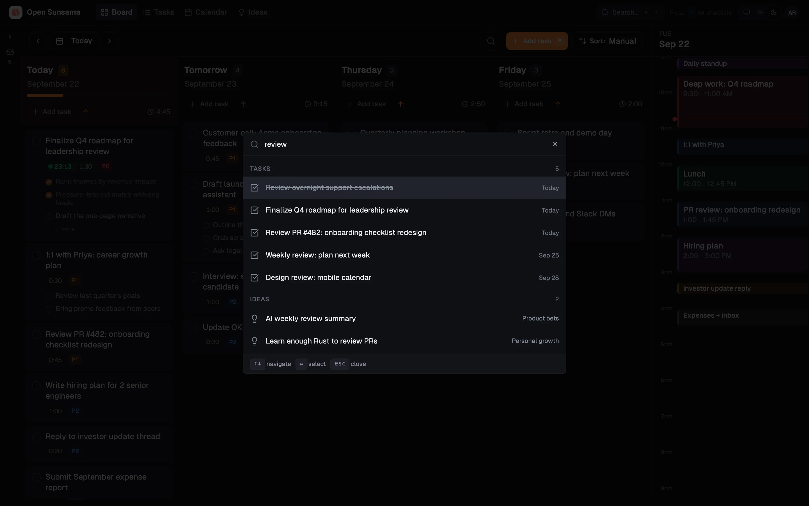

<div align="center">


# StudyOS

### Your complete study life, in one place.

The open-source, student-first planner for academic scheduling, assignment tracking, focused study blocks, and AI-assisted learning.

<br />

[](LICENSE)
[](.github/workflows/release.yml)
[](https://bun.sh)
[](https://react.dev)
[](apps/desktop)
[](apps/expo-mobile)

<br />

<picture>
  <source media="(prefers-color-scheme: dark)" srcset="docs/images/readme/today-dark.png" />
  
</picture>

<sub>StudyOS Today view: prioritized academic assignments, lecture schedules, and time-blocked study sessions in one distraction-free workspace.</sub>

</div>

<br />

---

## 📖 Introduction: What is StudyOS?

**StudyOS** is a unified, student-centered operating system for learning and daily execution. Most students juggle disjointed tools: a calendar for lectures, a to-do app for homework, spreadsheets for exam dates, separate note apps, and disjointed AI assistants. 

StudyOS brings your entire academic lifecycle together into a single, cohesive workflow:
1. **Academic Structuring:** Model your terms, courses, credit weights, grading criteria, and recurring lecture blocks.
2. **Assignment & Exam Tracking:** Track deliverables with strict due dates, priority tiers (P0–P3), estimated effort, and exam countdowns.
3. **Time-Blocking & Execution:** Drag assignments directly onto your calendar to schedule realistic study sessions.
4. **Distraction-Free Focus:** Run focused study intervals with native Pomodoro timers and streak tracking.
5. **AI Study Planner:** Ingest lecture slides and syllabus PDFs, generate candidate-validated review quizzes, and formulate optimized study plans using local or cloud AI models.
6. **Cross-Platform Synchronization:** Seamlessly transition between Windows desktop, Android mobile, and web with offline-first synchronization.

---

## ✨ Key Features

- **🗓️ Daily Planning Board:** Multi-day student kanban view with automatic rollover of unfinished work, priority indicators, and subtask progress.
- **📚 Subjects & Terms Architecture:** Organize coursework by academic semester, associate professors and color themes, and view upcoming workload by course.
- **⏳ Spaced Review & Exam Countdowns:** Automatically calculate review intervals leading up to midterms and finals, ensuring you never cram the night before.
- **⏱️ Focus Mode & Pomodoro Timer:** Full-screen focus mode with audio cues, actual vs. estimated time tracking, and streak counters.
- **📝 Contextual Study Notes & Materials:** Attach lecture PDFs, syllabus links, and rich-text notes (via Tiptap) directly to assignments.
- **🤖 Multi-Provider AI Study Planner:** Built-in AI router supporting Google Gemini, OpenAI, Anthropic Claude, DeepSeek, and local Ollama via encrypted API key storage.
- **🔄 Offline-First Sync Engine:** 4-tier revision resolution cascade with persistent 409 conflict quarantine—your offline work is never silently overwritten.
- **🔌 Model Context Protocol (MCP) Server:** 17 specialized academic tools enabling Claude, ChatGPT, Cursor, and Hermes Agent to assist with study planning.
- **⌨️ Keyboard-First Efficiency:** Global `⌘K` / `Ctrl+K` command palette to navigate courses, schedule tasks, and trigger focus timers instantly.

---

## 📸 Screenshots

<table>
<tr>
<td width="50%" valign="top">

### 📅 Calendar & Time-Blocking
Drag assignments and study blocks directly onto your schedule. Color-coded blocks link back to coursework so estimates meet reality.



</td>
<td width="50%" valign="top">

### 📝 Assignment Details & Subtasks
Break down complex projects into subtasks, log notes, configure priority tiers, set target estimates, and launch focus timers.



</td>
</tr>
<tr>
<td width="50%" valign="top">

### 📚 Course Subjects & Academic Workload
Track all enrolled subjects, active terms, professor details, and upcoming deadlines categorized by subject.



</td>
<td width="50%" valign="top">

### 🎯 Distraction-Free Focus Mode
One assignment, one timer. Everything else fades away so you can complete deep work intervals without tab fatigue.



</td>
</tr>
<tr>
<td width="50%" valign="top">

### 💡 Study Notes & Ideas Board
Trello-style boards for research papers, project ideas, reading lists, and long-term academic goals.



</td>
<td width="50%" valign="top">

### ⚡ Instant Command Palette (⌘K)
Jump to any subject, assignment, or setting in a single keystroke. Search across all notes and calendar events.



</td>
</tr>
</table>

---

## 📱 Cross-Platform Support

<table>
<tr>
<td width="30%" align="center" valign="top">

</td>
<td width="70%" valign="top">

### 🖥️ Windows Desktop
- **Native Tauri v2 Shell:** Lightweight, memory-efficient Windows desktop app built with Rust.
- **System Tray & Quick-Add:** Minimize to system tray with background daemon support and global hotkey quick-add.
- **Encrypted Local Storage:** Fast local SQLite and IndexedDB caching for offline study sessions.
- **Packaging:** Packaged via standard Windows NSIS installer (`StudyOS_{version}_x64-setup.exe`).

### 📱 Android Mobile
- **React Native 0.81 & Expo 54:** Fluid touch interactions, gesture handling, and responsive dark theme.
- **Offline Sync & Cache:** Full offline support with AsyncStorage caching and background mutation queue.
- **System Reminders:** Native device alarms and notification scheduling for assignment due dates.
- **Packaging:** Installable Universal APK (`StudyOS_{version}.apk`) and Google Play App Bundle (`StudyOS_{version}.aab`).

### 🌐 Web Application
- **Modern Web Architecture:** Responsive single-page application built with React 19, Vite, and Tailwind CSS.
- **Self-Hostable:** Portable static bundle packaged as `StudyOS_{version}_web.zip` for deployment to Cloudflare Pages, Nginx, or Docker.

</td>
</tr>
</table>

---

## 🏗️ Architecture & Technology Stack

StudyOS is engineered as a high-performance monorepo powered by **Turborepo** and **Bun**:

```
StudyOS/
├── apps/
│   ├── api/            # Hono REST API, WebSocket server, OAuth 2.1, and hosted /mcp
│   ├── web/            # React 19 + Vite web application and documentation portal
│   ├── desktop/        # Tauri v2 Windows desktop application (Rust host)
│   └── expo-mobile/    # Expo 54 / React Native 0.81 mobile application
├── packages/
│   ├── database/       # Drizzle ORM schemas, relationships, and PostgreSQL migrations
│   ├── api-client/     # Universal TypeScript API client with offline mutation queue
│   ├── types/          # Shared TypeScript domain models and validation schemas
│   └── utils/          # Shared date, time-blocking, and formatting helpers
├── mcp/                # Model Context Protocol stdio server with 17 academic tools
└── scripts/            # Cross-platform build preparation, signing, and verification scripts
```

### Core Technologies

| Layer | Technologies |
| :--- | :--- |
| **Monorepo & Package Management** | Bun 1.4.2 workspaces, Turborepo v2 |
| **Backend & API** | Hono v4, Drizzle ORM, PostgreSQL 16, PG Boss background jobs, Zod |
| **Web Frontend** | React 19, Vite 6, TanStack Query & Router, Tailwind CSS, Radix UI, Tiptap |
| **Desktop App** | Tauri v2, Rust stable toolchain, NSIS bundler |
| **Mobile App** | Expo 54, React Native 0.81.5 (Fabric / New Architecture), Reanimated 4 |
| **AI & Tool Protocol** | Model Context Protocol (MCP), Multi-provider LLM router (Gemini, Claude, OpenAI, DeepSeek, Ollama) |
| **Cryptography & Security** | AES-256-GCM encrypted credential vault, SHA-256 asset manifests, Row-Level Security (RLS) |

---

## 🚀 Getting Started (Local Development)

### Prerequisites
- **[Bun](https://bun.sh)** (v1.4.2 or higher)
- **[Node.js](https://nodejs.org)** (v22 LTS recommended)
- **[Docker & Docker Compose](https://www.docker.com)** (for local PostgreSQL)
- **[Rust](https://rustup.rs)** (stable, required only for building Windows desktop)
- **[Java 17](https://adoptium.net)** & Android SDK (required only for building Android)

### Quick Start in 3 Steps

1. **Clone the repository:**
   ```bash
   git clone https://github.com/saishivasanjeethpaikarao-jpg/StudyOS.git
   cd StudyOS
   ```

2. **Install dependencies:**
   ```bash
   bun install --frozen-lockfile
   ```

3. **Start local database & development environment:**
   ```bash
   # Launch local PostgreSQL 16 on localhost:5431
   docker compose up -d postgres

   # Start API server (:3001) and Web application (:3000)
   bun run dev:local
   ```

Open **`http://localhost:3000`** in your browser. The API server automatically applies database migrations on startup.

| Service | Local Address | Description |
| :--- | :--- | :--- |
| **Web Application** | `http://localhost:3000` | Student planner interface |
| **API Server** | `http://localhost:3001` | REST API and OAuth server |
| **WebSocket Feed** | `ws://localhost:3001/ws` | Real-time cross-device sync feed |
| **MCP Connector** | `http://localhost:3001/mcp` | Hosted AI Model Context Protocol endpoint |
| **PostgreSQL Database** | `localhost:5431` | Local development database (StudyOS container) |

---

## 📦 Building Platform Packages

### Build Web Application
```bash
bun run build --filter=@open-sunsama/web
# Static output generated in: apps/web/dist
```

### Build Windows Desktop Installer (.exe)
```bash
# Prepares web frontend and packages Tauri NSIS installer
cd apps/desktop
node scripts/prepare-frontend.mjs
bunx tauri build --bundles nsis
# Output located in: apps/desktop/src-tauri/target/release/bundle/nsis/
```

### Build Android Packages (APK & AAB)
```bash
cd apps/expo-mobile
bunx expo export --platform android
bunx expo prebuild --platform android --no-install
node ../../scripts/prepare-android-build.mjs
cd android
./gradlew assembleRelease bundleRelease --no-daemon
# APK output: apps/expo-mobile/android/app/build/outputs/apk/release/
# AAB output: apps/expo-mobile/android/app/build/outputs/bundle/release/
```

---

## 🚢 GitHub Actions Release Pipeline

StudyOS includes a unified CI/build/release pipeline located in [`.github/workflows/release.yml`](.github/workflows/release.yml).

### Strict Safety & Approval Gate
- **No Tag-Push Publishing:** Git tag pushes do not trigger releases.
- **Manual Trigger Only:** The release workflow can only be initiated via GitHub Actions **`workflow_dispatch`**.
- **Default Approval Gate (`publish_release: false`):** Runs all validation gates, compiles Windows, Android, and Web packages, computes SHA-256 hashes, and uploads artifacts for QA review **without creating a public GitHub Release**.
- **Official Publishing (`publish_release: true`):** Requires explicit approval. Strictly enforces production keystore signing, validates 5-workspace version synchronization, confirms 100% SHA-256 checksum concordance, and rejects any QA/debug-signed binaries.
- **Strict ₹0/Month Cost Target:** Uses Linux runners (1x cost) for validation, Android build, and release assembly. The Windows runner (2x cost) is strictly isolated to desktop packaging, and costly macOS runners are excluded.

---

## 🗺️ Project Roadmap (Phases 0–9)

StudyOS follows a fixed 10-phase roadmap:

- [x] **Phase 0 — Development Foundation:** Monorepo architecture, Bun workspaces, Docker development environment, and upstream provenance baseline.
- [x] **Phase 1 — StudyOS Academic Foundation:** Academic data models, terms, subjects, assignments, priority tiers, and grading criteria.
- [x] **Phase 2 — Study Planning Engine:** Exam countdowns, spaced review schedules, calendar time-blocking, and study block queues.
- [x] **Phase 3 — Resources & Productivity:** Material linking, syllabus attachments, Tiptap study notes, focus mode, and streak tracking.
- [x] **Phase 4 — Accounts & Cloud Sync:** Cross-platform sync engine, 4-tier revision cascade, and durable 409 conflict quarantine.
- [x] **Phase 5 — Android Application:** Expo 54 / React Native 0.81 client, offline cache persistence, and AlarmManager notification scheduling.
- [x] **Phase 6 — Windows Desktop Application:** Tauri v2 native shell, system tray daemon, global quick-add shortcut, and NSIS installer packaging.
- [x] **Phase 7 — AI Study Planner:** Multi-provider AI router (Gemini, Claude, OpenAI, DeepSeek, Ollama), AES-256-GCM secret storage, and quiz generation.
- [x] **Phase 8 — Integrations & Academic Agent:** Google Calendar export, Google Drive file ingestion, Telegram bot linking, and 17 academic MCP tools.
- [x] **Phase 9 — Production Release:**
  - [x] **Stage A:** Cross-platform ecosystem integration, sync conflict verification, and Docker line-ending normalization.
  - [x] **Stage B:** Unified GitHub Actions release pipeline, production keystore signing enforcement, pre-publish invariant verifier, and repository presentation.

---

## 🔒 Security & Privacy

- **Row-Level Security & Access Control:** Remote PostgreSQL database access is strictly governed. Public PostgREST exposure is locked down with default-deny policies.
- **Encrypted Secret Storage:** All third-party AI keys (Gemini, OpenAI, Anthropic) and calendar tokens are encrypted at rest using **AES-256-GCM**.
- **No Telemetry / No Tracking:** StudyOS collects zero telemetry, zero analytics tracking, and zero behavioral telemetry. Your academic schedules and notes remain yours.
- **Least-Privilege CI:** The GitHub Actions release workflow defaults to read-only permissions (`contents: read`), granting write permissions solely to the release job upon manual approval.

---

## 🤝 Contributing

Contributions from students, educators, and open-source developers are warmly welcomed!

1. Fork the repository and create your feature branch:
   ```bash
   git checkout -b feature/my-enhancement
   ```
2. Verify quality gates before committing:
   ```bash
   bun run typecheck
   bun run lint
   bun run test
   ```
3. Commit with semantic commit messages:
   ```bash
   git commit -m "feat(assignments): add assignment reminder intervals"
   ```
4. Push to your branch and submit a Pull Request targeted at **`studyos-development`**.

---

## 📄 License & Upstream Provenance

- **License:** StudyOS is distributed under a **Non-Commercial License** (Copyright © 2024–2026 Circo). It is free of charge for personal, educational, non-profit, and evaluation use. Commercial exploitation requires an enterprise license. See [`LICENSE`](LICENSE) for complete terms.
- **Upstream Provenance:** StudyOS inherits its foundational task and calendar architecture from [Open Sunsama](https://github.com/ShadowWalker2014/open-sunsama) (commit `fecaf22e9391c6c5ff0ccfed01892b98aa20a45d`). Historical authorship and open-source contributions are preserved in Git history and documented in [`docs/UPSTREAM_PROVENANCE.md`](docs/UPSTREAM_PROVENANCE.md).

<br />

<div align="center">

**StudyOS — Built for students who want to study smarter, stay organized, and execute every day.**

</div>
